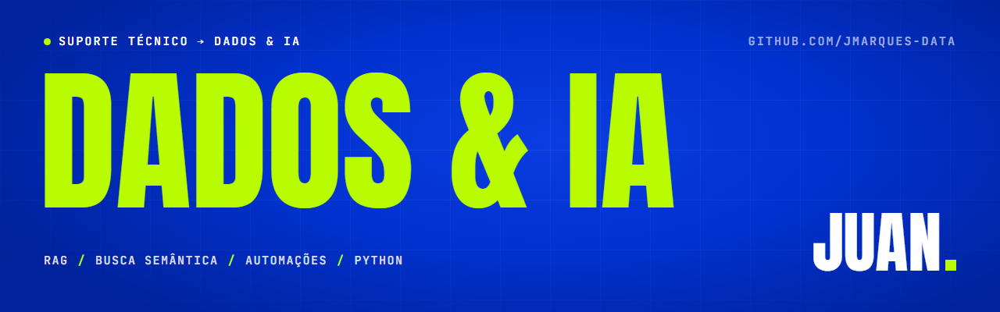

<p align="center">
  
</p>

<p align="center">
  <a href="https://www.linkedin.com/in/juanmarrques"></a>
  
</p>

Projetos práticos de **IA aplicada, dados e automação**. Todos com código aberto, dados fictícios e documentação em português e inglês.

## 🚀 Projetos

### 🤖 [Knowledge Base Vectorization](https://github.com/jmarques-data/knowledge-base-vectorization): assistente de suporte com RAG

<a href="https://github.com/jmarques-data/knowledge-base-vectorization"></a>

<a href="https://github.com/jmarques-data/knowledge-base-vectorization/actions/workflows/testes.yml"></a>   

**Problema:** no suporte de TI, a solução de um chamado costuma estar escondida em POPs e tickets antigos, e procurar leva tempo.
**Solução:** o analista pergunta em português, o sistema encontra os trechos certos da base e o Claude responde com os passos, **citando a fonte** de cada informação.

```text
Pergunta → embedding → busca semântica no ChromaDB → trechos relevantes
         → Claude → resposta com os passos e as fontes [arquivo#trecho]
```

| | |
|---|---|
| **Stack** | Python · ChromaDB · all-MiniLM-L6-v2 · Claude (SDK `anthropic`) · pytest · GitHub Actions |
| **Destaques** | Resposta com citação das fontes · diz quando a base não tem a resposta · modo só busca, sem chave · 13 testes rodando no CI (Python 3.10 e 3.12) |
| **Experimente** | `python perguntar.py "Sistema não abre: host remoto não encontrado"` |
| **Próximos passos** | Chunking por seções do Markdown · remover trechos duplicados · medir a qualidade das respostas |

### 🧠 [Segundo Cérebro com IA](https://github.com/jmarques-data/segundo-cerebro-ia): sistema de organização com Claude Code

<a href="https://github.com/jmarques-data/segundo-cerebro-ia"></a>

  

**Problema:** estudos, carreira e projetos espalhados na cabeça, em notas soltas e lembretes esquecidos.
**Solução:** um modelo de pastas Markdown com regras e comandos para o Claude Code capturar, organizar e revisar tudo junto com você.

| | |
|---|---|
| **Estrutura** | 8 áreas (inbox, projetos, skills, agents, vida pessoal, vida, carreira, vídeos) + arquivo morto |
| **Comandos** | `/capturar` · `/revisar-semana` · `/vagas-status` (versão em inglês: `/capture` · `/weekly-review` · `/jobs-status`) |
| **Regras da IA** | Escreve em português · pergunta antes de editar · nunca apaga arquivos · não registra dados sensíveis |
| **Experimente** | Copie a pasta `pt-BR/` (ou `en/`) e abra com o Claude Code |

## 🧰 Stack dos projetos

         

---

<sub>🇺🇸 <b>In English:</b> hands-on open-source projects in applied AI, data and automation: a RAG-based IT support assistant (Python, ChromaDB, Claude) and a Claude Code second-brain template. Docs in Portuguese and English.</sub>
