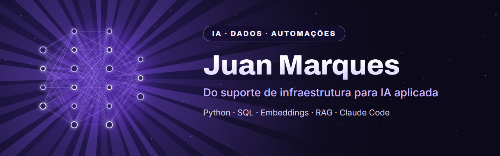

  

  
  
  

## 👋 Olá, eu sou o Juan

Sou **Técnico de Suporte N2** e estou terminando **Análise e Desenvolvimento de Sistemas** na Newton Paiva (conclusão em dezembro de 2026).

No dia a dia, resolvo problemas de infraestrutura e escrevo documentação que outras pessoas conseguem seguir sozinhas. Fora dele, construo projetos práticos de **IA aplicada, dados e automação**: pipelines de embeddings, busca semântica e fluxos de trabalho com o **Claude Code**.

Gosto de IA que resolve problema de verdade, não como buzzword. Por isso, cada projeto aqui é construído em camadas, validando uma antes de empilhar a próxima.

## 🚀 Projetos em destaque

<table>
  <tr>
    <td width="50%" valign="top">
      
      <h3><a href="https://github.com/jmarques-data/segundo-cerebro-ia">Segundo Cérebro com IA</a></h3>
      Modelo de segundo cérebro em Markdown para usar com o Claude Code: capturar, organizar, revisar a semana e decidir as próximas ações.
        
      <code>Claude Code</code> <code>Markdown</code> <code>Produtividade</code>
    </td>
    <td width="50%" valign="top">
      
      <h3><a href="https://github.com/jmarques-data/knowledge-base-vectorization">Knowledge Base Vectorization</a></h3>
      Pipeline em Python que transforma documentação técnica em embeddings e guarda tudo no ChromaDB: a base para busca semântica e RAG.
        
      <code>Python</code> <code>ChromaDB</code> <code>Embeddings</code>
    </td>
  </tr>
</table>

## 🧰 Ferramentas

**IA aplicada** 
   

**Dados e automação** 
   

**Infraestrutura (dia a dia)** 
   

## 🧭 Agora

- 🔨 Construindo a camada de **busca semântica** e o primeiro **RAG** do Knowledge Base Vectorization
- 📚 Aprofundando **SQL** e **Python** para dados
- 🎯 Buscando vagas **remotas ou híbridas** em dados, IA e automação

---

🇺🇸 <b>In English:</b> IT support analyst (Tier 2) finishing a degree in Systems Analysis and Development, building hands-on projects in applied AI, data and automation: embeddings, semantic search and Claude Code workflows. Open to remote or hybrid roles in data and AI.
